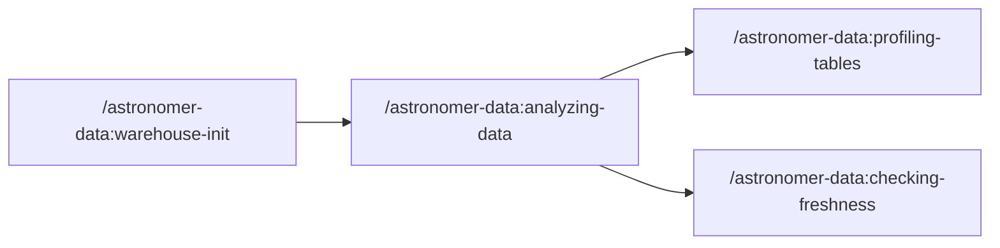
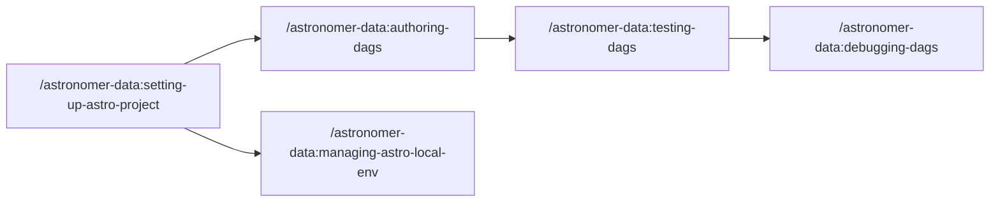

# agents

AI agent tooling for data engineering workflows. Includes an [MCP server](./astro-airflow-mcp/) for Airflow, a [CLI tool (`af`)](./astro-airflow-mcp/README.md#airflow-cli-tool) for interacting with Airflow from your terminal, and [skills](#skills) that extend AI coding agents with specialized capabilities for working with Airflow and data warehouses. Works with [Claude Code](https://docs.anthropic.com/en/docs/claude-code), [Cursor](https://cursor.com), and other agentic coding tools.

Built by [Astronomer](https://www.astronomer.io/). [Apache 2.0 licensed](https://github.com/astronomer/agents/blob/main/LICENSE) and compatible with open-source Apache Airflow.

## Table of Contents

<!-- START doctoc generated TOC please keep comment here to allow auto update -->
<!-- DON'T EDIT THIS SECTION, INSTEAD RE-RUN doctoc TO UPDATE -->

- [Installation](#installation)
  - [Quick Start](#quick-start)
  - [Compatibility](#compatibility)
  - [Claude Code](#claude-code)
  - [Cursor](#cursor)
  - [Other MCP Clients](#other-mcp-clients)
- [Features](#features)
  - [MCP Server](#mcp-server)
  - [Skills](#skills)
- [Why Astro?](#why-astro)
  - [User Journeys](#user-journeys)
  - [Airflow CLI (`af`)](#airflow-cli-af)
- [Configuration](#configuration)
  - [Warehouse Connections](#warehouse-connections)
  - [Airflow](#airflow)
- [Usage](#usage)
  - [Getting Started](#getting-started)
- [Development](#development)
  - [Local Development Setup](#local-development-setup)
  - [Adding Skills](#adding-skills)
- [Troubleshooting](#troubleshooting)
  - [Common Issues](#common-issues)
- [Contributing](#contributing)
- [Roadmap](#roadmap)
- [License](#license)

<!-- END doctoc generated TOC please keep comment here to allow auto update -->

## Installation

### Quick Start

```bash
npx skills add astronomer/agents --skill '*'
```

This installs all Astronomer skills into your project via [skills.sh](https://skills.sh). You'll be prompted to select which agents to install to. To also select skills individually, omit the `--skill` flag.

> [!IMPORTANT]
> **Claude Code users:** We recommend using the plugin instead (see [Claude Code](#claude-code) section below) for better integration with MCP servers and hooks.

### Compatibility

**Skills:** Works with [25+ AI coding agents](https://github.com/vercel-labs/add-skill?tab=readme-ov-file#available-agents) including Claude Code, Cursor, VS Code (GitHub Copilot), Windsurf, Cline, and more.

**MCP Server:** Works with any [MCP-compatible client](https://modelcontextprotocol.io/clients) including Claude Desktop, VS Code, and others.

> [!NOTE]
> **Open-source Airflow users:** The MCP server works with any Airflow 2.x/3.x REST API. Set `AIRFLOW_API_URL` to your self-hosted instance. Skills are tool-agnostic and work with any Airflow deployment.

### Claude Code

```bash
# Add the marketplace and install the plugin
claude plugin marketplace add astronomer/agents
claude plugin install astronomer-data@astronomer

# Upgrading from the old plugin name? Uninstall first:
# claude plugin uninstall data@astronomer && claude plugin marketplace update && claude plugin install astronomer-data@astronomer
```

The plugin includes the Airflow MCP server that runs via `uvx` from PyPI. Data warehouse queries are handled by the `analyzing-data` skill using a background Jupyter kernel.

### Cursor

Cursor supports both MCP servers and skills.

**MCP Server** - Click to install:

<a href="https://cursor.com/en-US/install-mcp?name=astro-airflow-mcp&config=eyJjb21tYW5kIjoidXZ4IiwiYXJncyI6WyJhc3Ryby1haXJmbG93LW1jcCIsIi0tdHJhbnNwb3J0Iiwic3RkaW8iXX0"></a>

**Skills** - Install to your project:

```bash
npx skills add astronomer/agents --skill '*' -a cursor
```

This installs skills to `.cursor/skills/` in your project.

<details>
<summary>Manual MCP configuration</summary>

Add to `~/.cursor/mcp.json`:

```json
{
  "mcpServers": {
    "airflow": {
      "command": "uvx",
      "args": ["astro-airflow-mcp", "--transport", "stdio"]
    }
  }
}
```

</details>

<details>
<summary>Enable hooks (session management)</summary>

Create `.cursor/hooks.json` in your project:

```json
{
  "version": 1,
  "hooks": {
    "stop": [
      {
        "command": "uv run $CURSOR_PROJECT_DIR/.cursor/skills/analyzing-data/scripts/cli.py stop",
        "timeout": 10
      }
    ]
  }
}
```

**What these hooks do:**
- `stop`: Cleans up kernel when session ends

</details>

### Other MCP Clients

For any MCP-compatible client (Claude Desktop, VS Code, etc.):

```bash
# Airflow MCP
uvx astro-airflow-mcp --transport stdio

# With remote Airflow
AIRFLOW_API_URL=https://your-airflow.example.com \
AIRFLOW_USERNAME=admin \
AIRFLOW_PASSWORD=admin \
uvx astro-airflow-mcp --transport stdio
```

## Features

The `astronomer-data` plugin bundles an MCP server and skills into a single installable package.

### MCP Server

| Server | Description |
|--------|-------------|
| **[Airflow](https://github.com/astronomer/agents/tree/main/astro-airflow-mcp)** | Full Airflow REST API integration via [astro-airflow-mcp](https://github.com/astronomer/agents/tree/main/astro-airflow-mcp): DAG management, triggering, task logs, system health |

### Skills

#### Data Discovery & Analysis

| Skill | Description |
|-------|-------------|
| [warehouse-init](./skills/warehouse-init/) | Initialize schema discovery - generates `.astro/warehouse.md` for instant lookups |
| [analyzing-data](./skills/analyzing-data/) | SQL-based analysis to answer business questions (uses background Jupyter kernel) |
| [checking-freshness](./skills/checking-freshness/) | Check how current your data is |
| [profiling-tables](./skills/profiling-tables/) | Comprehensive table profiling and quality assessment |

#### Data Lineage

| Skill | Description |
|-------|-------------|
| [tracing-downstream-lineage](./skills/tracing-downstream-lineage/) | Analyze what breaks if you change something |
| [tracing-upstream-lineage](./skills/tracing-upstream-lineage/) | Trace where data comes from |
| [annotating-task-lineage](./skills/annotating-task-lineage/) | Add manual lineage to tasks using inlets/outlets |
| [creating-openlineage-extractors](./skills/creating-openlineage-extractors/) | Build custom OpenLineage extractors for operators |

#### DAG Development

| Skill | Description |
|-------|-------------|
| [airflow](./skills/airflow/) | Main entrypoint - routes to specialized Airflow skills |
| [setting-up-astro-project](./skills/setting-up-astro-project/) (Astro) | Initialize and configure new Astro/Airflow projects |
| [managing-astro-local-env](./skills/managing-astro-local-env/) (Astro) | Manage local Airflow environment (start, stop, logs, troubleshoot) |
| [authoring-dags](./skills/authoring-dags/) | Create and validate Airflow DAGs with best practices |
| [blueprint](./skills/blueprint/) | Compose DAGs from YAML using reusable templates with Pydantic validation ([airflow-blueprint](https://github.com/astronomer/blueprint)) |
| [testing-dags](./skills/testing-dags/) | Test and debug Airflow DAGs locally |
| [debugging-dags](./skills/debugging-dags/) | Deep failure diagnosis and root cause analysis |
| [deploying-airflow](./skills/deploying-airflow/) | Deploy Airflow DAGs and projects (Astro, Docker Compose, Kubernetes) |
| [airflow-hitl](./skills/airflow-hitl/) | Human-in-the-loop workflows: approval gates, form input, branching (Airflow 3.1+) |

#### dbt Integration

| Skill | Description |
|-------|-------------|
| [cosmos-dbt-core](./skills/cosmos-dbt-core/) | Run dbt Core projects as Airflow DAGs using [Astronomer Cosmos](https://github.com/astronomer/astronomer-cosmos) |
| [cosmos-dbt-fusion](./skills/cosmos-dbt-fusion/) | Run dbt Fusion projects with Cosmos (Snowflake/Databricks only) |

#### Migration

| Skill | Description |
|-------|-------------|
| [migrating-airflow-2-to-3](./skills/migrating-airflow-2-to-3/) | Migrate DAGs from Airflow 2.x to 3.x |

## Why Astro?

Astro is Astronomer's managed Airflow platform. It's optional, but a good fit if you want managed deployments, built-in alerting, and centralized observability across environments. If you run open-source Airflow, everything in this repo still applies—you'll just configure your own Airflow URL and infrastructure.

### User Journeys

#### Data Analysis Flow



1. **Initialize** (`/astronomer-data:warehouse-init`) - One-time setup to generate `warehouse.md` with schema metadata
2. **Analyze** (`/astronomer-data:analyzing-data`) - Answer business questions with SQL
3. **Profile** (`/astronomer-data:profiling-tables`) - Deep dive into specific tables for statistics and quality
4. **Check freshness** (`/astronomer-data:checking-freshness`) - Verify data is up to date before using

#### DAG Development Flow

For open-source Airflow, use Docker Compose for local dev and the Helm chart for production (see `deploying-airflow`) instead of Astro setup skills.



1. **Setup** (`/astronomer-data:setting-up-astro-project`) - Initialize project structure and dependencies
2. **Environment** (`/astronomer-data:managing-astro-local-env`) - Start/stop local Airflow for development
3. **Author** (`/astronomer-data:authoring-dags`) - Write DAG code following best practices
4. **Test** (`/astronomer-data:testing-dags`) - Run DAGs and fix issues iteratively
5. **Debug** (`/astronomer-data:debugging-dags`) - Deep investigation for complex failures

### Airflow CLI (`af`)

The `af` command-line tool lets you interact with Airflow directly from your terminal. Install it with:

```bash
uvx --from astro-airflow-mcp af --help
```

For frequent use, add an alias to your shell config (`~/.bashrc` or `~/.zshrc`):

```bash
alias af='uvx --from astro-airflow-mcp af'
```

Then use it for quick operations like `af health`, `af dags list`, or `af runs trigger <dag_id>`.

See the [full CLI documentation](./astro-airflow-mcp/README.md#airflow-cli-tool) for all commands and instance management.

> **Telemetry:** The `af` CLI collects anonymous usage telemetry to help improve the tool. Only the command name is collected (e.g., `dags list`), never the arguments or their values. Opt out with `af telemetry disable`.

## Configuration

### Warehouse Connections

Configure data warehouse connections at `~/.astro/agents/warehouse.yml`:

```yaml
my_warehouse:
  type: snowflake
  account: ${SNOWFLAKE_ACCOUNT}
  user: ${SNOWFLAKE_USER}
  auth_type: private_key
  private_key_path: ~/.ssh/snowflake_key.p8
  private_key_passphrase: ${SNOWFLAKE_PRIVATE_KEY_PASSPHRASE}
  warehouse: COMPUTE_WH
  role: ANALYST
  query_tag: claude-code
  databases:
    - ANALYTICS
    - RAW
```

> [!IMPORTANT]
> **How the `databases` list works:**
> - **Optional for most connectors** (`snowflake`, `postgres`, `bigquery`) but **required for `sqlalchemy`**
> - **For schema discovery** (`/astronomer-data:warehouse-init`): Determines which databases are scanned and included in the generated `.astro/warehouse.md`. Only databases listed here will be discovered. If omitted, no schema discovery will occur.
> - **For query execution** (`/astronomer-data:analyzing-data`): The **first database** in the list becomes the default database context for the connection, but does NOT restrict which databases you can query. You can still access any database you have permissions for using fully-qualified table names (