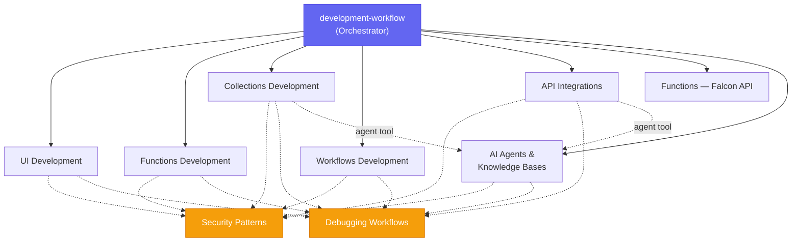

# Falcon Foundry Skills

[](https://github.com/CrowdStrike/foundry-skills/releases/tag/v1.6.0)
[](https://github.com/CrowdStrike/foundry-skills/actions/workflows/main.yml)

AI coding assistant skills for building [CrowdStrike Falcon Foundry](https://www.crowdstrike.com/en-us/platform/next-gen-siem/falcon-foundry/) apps. Build Foundry apps from a natural language prompt — API integrations, workflows, UI pages, functions, collections, AI agents, and knowledge bases — all scaffolded with the Foundry CLI and deployed to the Falcon console.

## Getting Started

### Prerequisites

- **Foundry CLI**: Install with `brew tap crowdstrike/foundry-cli && brew install crowdstrike/foundry-cli/foundry` (macOS/Linux) or [download for Windows](https://assets.foundry.crowdstrike.com/cli/latest/foundry_Windows_x86_64.zip)
- **CrowdStrike Account**: With Falcon Foundry access
- **Authentication**: Run `foundry login` to authenticate
- **AI Coding Assistant**: Claude Code, Codex, Copilot CLI, Cursor, Antigravity CLI, or any tool that supports loading reference documentation

### Install

| Assistant | Command | Marketplace |
|-----------|---------|-------------|
| Claude Code | `/plugin install crowdstrike-falcon-foundry` | [Anthropic](https://claude.com/plugins/crowdstrike-falcon-foundry) |
| Codex | `codex plugin add crowdstrike-falcon-foundry@openai-api-curated` | [OpenAI](https://chatgpt.com/plugins/plugins_6a8f6d7f7fac819191e3eba5a7a2e0df) |
| Copilot CLI | `copilot plugin install CrowdStrike/foundry-skills` | [GitHub](https://awesome-copilot.github.com/plugin/crowdstrike-falcon-foundry/) |
| Cursor | `/plugins` (CLI) or `/add-plugin crowdstrike-falcon-foundry` (IDE) | [Cursor](https://cursor.com/marketplace/crowdstrike/crowdstrike-falcon-foundry) |
| Antigravity CLI | `agy plugin install https://github.com/CrowdStrike/foundry-skills` | [Google](https://antigravity.google/docs/plugins) |

> [!NOTE]
> **Codex** has two install paths depending on how you signed in. The command above installs from the curated CLI marketplace, which **API-key and Amazon Bedrock** sessions load. If you authenticated Codex with a **ChatGPT** account, that marketplace isn't loaded — instead run `/plugins` inside Codex, search for `crowdstrike`, and install from the results.

All five assistants have been verified end to end: the skills were loaded from a local clone, then used to build and deploy an app to a live Falcon Foundry tenant from the example prompt below.

For local development with Claude Code, use `claude --plugin-dir /path/to/foundry-skills`. These skills follow the [Agent Plugins](https://agent-plugins.org) format and include a `.codex-plugin/plugin.json` manifest for native Codex discovery. See the [blog post](https://www.crowdstrike.com/tech-hub/ng-siem/build-falcon-foundry-apps-with-claude-code/) for a full walkthrough.

<details>
<summary><strong>Install from a local clone</strong> (for development or testing a branch)</summary>

```bash
git clone https://github.com/CrowdStrike/foundry-skills.git
```

| Assistant | Command |
|-----------|---------|
| Claude Code | `claude --plugin-dir /path/to/foundry-skills` |
| Copilot CLI | `copilot --plugin-dir /path/to/foundry-skills` |
| Cursor | `agent --plugin-dir /path/to/foundry-skills` |
| Antigravity CLI | `agy plugin install /path/to/foundry-skills` |

Codex has no `--plugin-dir`. It discovers skills from `~/.agents/skills/` instead, one symlink per skill:

```bash
mkdir -p ~/.agents/skills
for skill in /path/to/foundry-skills/skills/*/; do
  ln -s "${skill%/}" ~/.agents/skills/
done
```

`~/.agents/skills/` is a flat, shared namespace: foundry-skills' skill names don't overlap with fusion-skills', so both can be symlinked in together. A marketplace or `--plugin-dir` install namespaces the skills as `crowdstrike-falcon-foundry:<skill>` and sidesteps the question entirely. Edits are live immediately. Restart Codex to re-index.

</details>

## Usage

### Example prompt

This prompt exercises the full skill set — API integration, workflow, and UI:

> Create a Falcon Foundry app for me that has an Okta API integration with openapi. Share its listusers endpoint with Falcon Fusion SOAR. Then, create a workflow that can be run on-demand to email or print the list of users. Finally, create a UI extension that calls the listusers endpoint and displays the results.

### How plugin skill routing works

Repository-backed installs in Claude Code, Codex, Copilot CLI, and Cursor include hooks that ensure the right skills get used. Codex requires reviewing and trusting bundled hooks through `/hooks` before they run. Cursor loads them from `.cursor-plugin/plugin.json`:

1. **`UserPromptSubmit` hook** — Matches an action verb paired with a Foundry noun — e.g., "create a foundry app". Explicit CLI commands and skill requests also trigger it.

2. **`PreToolUse` hook** — When Foundry intent is detected, injects a non-blocking advisory reminder to use the Foundry workflow skill. The assistant can still use all tools normally. The one exception is `foundry api-integrations create`, which is blocked when the OpenAPI spec can't be adapted for Falcon Foundry. In Claude Code, calls to `superpowers:brainstorming` get advice to switch to the Foundry workflow skill when the task is Foundry app work.

3. **`PreToolUse` hook (CLI guard)** — Checks shell commands and flags Foundry CLI commands missing the `--no-prompt` flag (prevents `Error: EOF` failures) and manual directory creation for app structure (prevents invalid `manifest.yml`). It's advisory: it adds guidance to the tool call rather than blocking it, and you'll only see it when it catches a problem. Cursor's shell tool is `Shell`; the guard treats that the same as Claude's `Bash`.

Hooks observe prompts and tool I/O to keyword-match Foundry-specific actions; no data leaves the session.

Local Codex installs made with skill symlinks, and other assistants that do not load bundled hooks, must apply the documented `--no-prompt` guardrails and run the OpenAPI adaptation helper explicitly. Skill-specific helpers live beside their `SKILL.md` files so Agent Skills and plugin installations remain self-contained; this packaging is separate from Falcon Foundry CLI connectivity, which is covered by the sandbox diagnostics in the debugging skill.

## Skills

| Skill | Purpose |
|-------|---------|
| `development-workflow` | Primary orchestrator — coordinates the full app lifecycle |
| `api-integrations` | OpenAPI spec import, auth scheme configuration, SOAR sharing |
| `functions-falcon-api` | Calling Falcon APIs from within Functions (OAuth, SDKs) |
| `workflows-development` | YAML workflow creation, Falcon Fusion SOAR actions and triggers |
| `ui-development` | React/Vue UI pages with Shoelace components and Falcon theming |
| `functions-development` | Go/Python serverless functions with CrowdStrike SDK |
| `collections-development` | JSON Schema data modeling and CRUD operations |
| `ai-agents-development` | AI agents and knowledge bases, plus exposing collections and API operations as agent tools |
| `security-patterns` | OAuth scoping, input validation, content security |
| `debugging-workflows` | Systematic troubleshooting for CLI, manifest, and deployment issues |
| `e2e-testing` | End-to-end testing with `@crowdstrike/foundry-playwright` |
| `app-upgrades` | Upgrade a template-installed app to a newer template version in place |
| `fusion-redirect` | Declines standalone Falcon Fusion workflow requests and points to the `crowdstrike-falcon-fusion` plugin |

## Architecture

The skills follow a hub-and-spoke pattern. `development-workflow` is the orchestrator that parses your requirements, runs CLI commands for scaffolding, and delegates capability-specific implementation to sub-skills:



## Use Cases

The `use-cases/` directory contains real-world implementation patterns extracted from [CrowdStrike Tech Hub](https://www.crowdstrike.com/tech-hub/ng-siem/) blog posts:

- API pagination strategies
- Detection enrichment with UI extensions
- LogScale data ingestion from functions
- Lookup table enrichment with 3rd-party data
- Custom SOAR actions
- NGSIEM query export to CSV/JSON
- Publishing certified apps
- And more (see [use-cases/README.md](use-cases/README.md))

## Recommended Companion: Superpowers

These skills pair well with [obra/superpowers](https://github.com/obra/superpowers), which adds structured planning, TDD discipline, and code review workflows. Foundry skills handle the Foundry-specific CLI and platform knowledge while superpowers provides general software engineering best practices.

See [skills/development-workflow/references/superpowers-integration.md](skills/development-workflow/references/superpowers-integration.md) for details on how they work together.

**Note:** The without-superpowers path produces more reliable results because the Foundry skill has full control from the start. Superpowers brainstorming loads first and creates a plan before the Foundry skills are read, which may not follow Foundry-specific patterns.

## Foundry CLI Quick Reference

```bash
foundry login                                                    # Authenticate
foundry apps create --name "My App" --no-prompt --no-git         # Create app
foundry api-integrations create --name "X" --spec /tmp/spec.json --no-prompt  # Add API integration
foundry ui pages create --name "X" --from-template React --no-prompt          # Add UI page
foundry ui extensions create --name "X" --from-template React --sockets "activity.detections.details" --no-prompt  # Add UI extension
foundry functions create --name "X" --language python --no-prompt              # Add function
foundry collections create --name "X" --schema /tmp/schema.json --no-prompt   # Add collection
foundry workflows create --name "X" --spec /tmp/workflow.yaml --no-prompt     # Add workflow
foundry knowledge-bases create --name "X" --description "desc" --files /tmp/doc.md --no-prompt  # Add knowledge base
foundry agents create --name "X" --description "desc" --system-prompt /tmp/prompt.md --expose-charlotte-chat --no-prompt  # Add AI agent
foundry apps deploy --change-type Patch --change-log "msg" --no-prompt  # Deploy to cloud
foundry apps release                                             # Release to catalog
```

## Troubleshooting

### Skills not invoked

If Claude doesn't use Foundry skills automatically, phrase your prompt with a clear action verb and Foundry noun (e.g., "create a foundry app", "fix the foundry function"). You can also say "Use Foundry skills" at any point to redirect.

### CLI authentication

```bash
foundry profile active    # Check current profile
foundry login             # Re-authenticate
foundry profile list      # List all profiles
```

### Deployment failures

1. Validate immediately after `foundry api-integrations create` (`foundry apps validate --no-prompt`) — Foundry's server-side OpenAPI parser is stricter than `redocly lint` and may reject large vendor specs
2. Run `foundry apps deplo