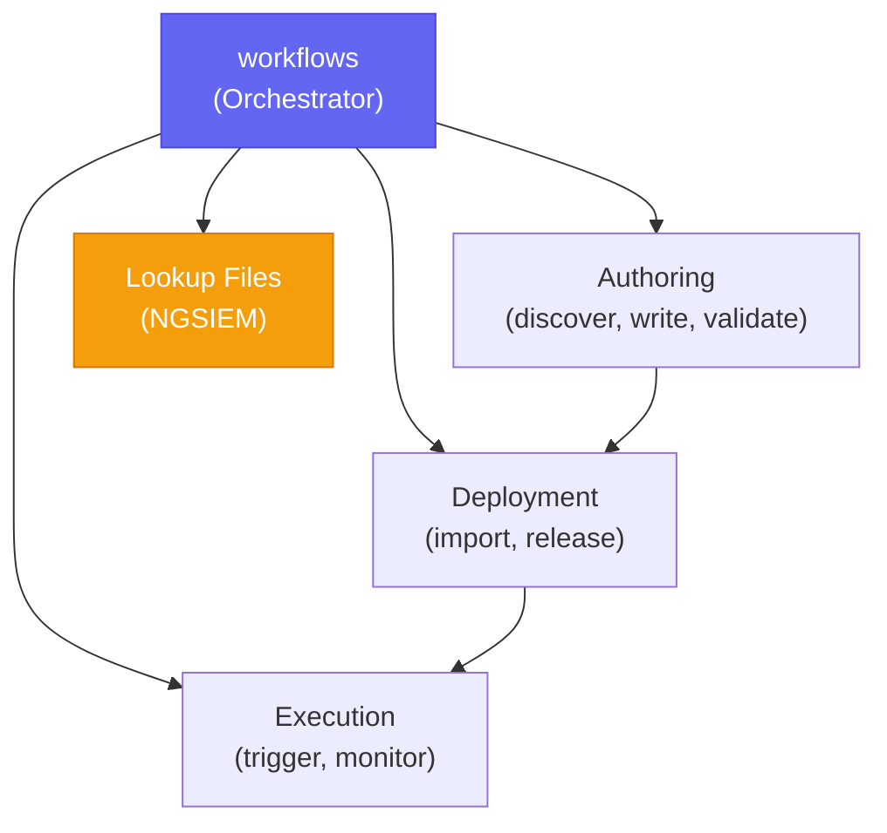

# Falcon Fusion Skills

[](https://github.com/CrowdStrike/fusion-skills/releases/tag/v1.4.0)
[](https://github.com/CrowdStrike/fusion-skills/actions/workflows/main.yml)

AI coding assistant skills for building [CrowdStrike Falcon Fusion](https://www.crowdstrike.com/en-us/platform/next-gen-siem/falcon-fusion/) workflows. Go from a natural language prompt to a working Fusion workflow — discover real action IDs from the live API, author the YAML, validate it against the platform schema, import it to a CID, and trigger and monitor its execution.

> `fusion-skills` is a community-driven, open source project, not a CrowdStrike product. As such, it carries no formal support, expressed or implied.

## Getting Started

### Prerequisites

- **CrowdStrike Account** with the **Workflow** API scope (plus **NGSIEM Lookup Files** for the lookup-files skill)
- **AI Coding Assistant**: Claude Code, Codex, Copilot CLI, Cursor, Antigravity CLI, or any tool that can read local reference documentation
- **[jq](https://jqlang.org/)** for the skill-routing hooks (without it, the hooks stay silent)

### Install

| Assistant | Command | Marketplace |
|-----------|---------|-------------|
| Claude Code | `/plugin install crowdstrike-falcon-fusion` | [Anthropic](https://github.com/anthropics/claude-plugins-official) |
| Codex | `codex plugin add crowdstrike-falcon-fusion@openai-api-curated` | [OpenAI](https://chatgpt.com/plugins/plugins_6a8f7048ed7881918bf5b79011fe2b5e) |
| Copilot CLI | `copilot plugin install CrowdStrike/fusion-skills` | [GitHub](https://awesome-copilot.github.com/plugin/crowdstrike-falcon-fusion/) |
| Cursor | `/plugins` (CLI) or `/add-plugin crowdstrike-falcon-fusion` (IDE) | [Cursor](https://cursor.com/marketplace/crowdstrike/crowdstrike-falcon-fusion) |
| Antigravity CLI | `agy plugin install https://github.com/CrowdStrike/fusion-skills` | [Google](https://antigravity.google/docs/plugins) |

> [!NOTE]
> **Codex** has two install paths depending on how you signed in. The command above installs from the curated CLI marketplace, which **API-key and Amazon Bedrock** sessions load. If you authenticated Codex with a **ChatGPT** account, that marketplace isn't loaded — instead run `/plugins` inside Codex, search for `crowdstrike`, and install from the results.

In a live-tenant run, all five assistants (Claude Code, Codex, Copilot CLI, Cursor, and Antigravity CLI) each authored a valid workflow from the example prompt below and imported it to the tenant.

These skills follow the [Agent Plugins](https://agent-plugins.org) format, with a root `plugin.json` and a Codex `.codex-plugin/plugin.json` so the non-Claude assistants can discover them. See the [blog post](https://www.crowdstrike.com/tech-hub/ng-siem/build-falcon-fusion-workflows-with-claude-code/) for a full walkthrough.

<details>
<summary><strong>Install from a local clone</strong> (for development or testing a branch)</summary>

```bash
git clone https://github.com/CrowdStrike/fusion-skills.git
```

| Assistant | Command |
|-----------|---------|
| Claude Code | `claude --plugin-dir /path/to/fusion-skills` |
| Copilot CLI | `copilot --plugin-dir /path/to/fusion-skills` |
| Cursor | `agent --plugin-dir /path/to/fusion-skills --trust` |
| Antigravity CLI | `agy plugin install /path/to/fusion-skills` |

Codex has no `--plugin-dir`; it discovers skills from `~/.agents/skills/`, one symlink per skill (Copilot CLI and Cursor can use this directory too):

```bash
mkdir -p ~/.agents/skills
for skill in /path/to/fusion-skills/skills/*; do
  ln -s "$skill" ~/.agents/skills/
done
```

`~/.agents/skills/` is a flat, shared namespace: fusion-skills' skill names don't overlap with foundry-skills', so both can be symlinked in together. A marketplace or `--plugin-dir` install namespaces the skills as `crowdstrike-falcon-fusion:<skill>` and sidesteps the question entirely. Restart the assistant after symlinking; some prompt for authentication on first run.

</details>

### Credentials

These skills authenticate with a Falcon API client. In the console, go to **Support and resources** > **Client Management** > **Create API client**, grant the **Workflow** scope (read and write), and, for the `lookup-files` skill, also **NGSIEM Lookup Files** (read and write). Copy the client ID and secret shown once on creation, then configure them below.

Configure credentials once. Run the interactive setup skill — it writes a profile to `~/.cache/crowdstrike-falcon-fusion/credentials.toml`:

```
/crowdstrike-falcon-fusion:setup
```

For CI or a one-off override, set environment variables instead:

```bash
export FALCON_CLIENT_ID=your_client_id_here
export FALCON_CLIENT_SECRET=your_client_secret_here
# Optional on US-1, US-2, and EU-1 (FalconPy discovers the region). Set it for any other cloud, such as US-3 or GovCloud:
# export FALCON_BASE_URL=https://api.us-3.crowdstrike.com  # US-GOV-1: https://api.laggar.gcw.crowdstrike.com
```

Credentials come from environment variables (checked first) or the TOML profile, and are never hardcoded. Either source can hold a 1Password secret reference (`op://<vault>/<item>/<field>`) instead of the client ID or secret, which `auth.py` reads with the 1Password CLI so the secret stays off disk. On a network that re-signs TLS traffic, set a profile's `ca_bundle` to your organization's CA bundle. See the [setup skill](skills/setup/SKILL.md) for both. Verify your setup:

```bash
python common/scripts/auth.py
```

### Other Tools

These skills are plain markdown files. Any AI coding assistant that can read local files can use them. See [AGENTS.md](AGENTS.md) for the full development guide, or point your tool at the `skills/` directory and start with `workflows/SKILL.md` as the entry point.

## Usage

### Example prompt

This prompt exercises the full lifecycle: action discovery, event queries, parallel HTTP Action enrichment, an LLM completion action, and validation:

> Generate a Falcon Fusion workflow that will trigger from a Falcon Next-Gen SIEM detection. The workflow should hydrate the detection using an event query to get the full details of the detection. If a user, host, domain, url, file indicator, or ip indicator is found, enrich each in parallel using HTTP calls to VirusTotal or DomainTools. Summarize the enrichment across all the threat intelligence providers using an LLM completion action and then send an email formatted in HTML.

Describe what you want in plain language. You don't need to name a skill. The orchestrator picks the right one.

### How skill routing works

Repository-backed installs in Claude Code, Codex, Copilot CLI, and Cursor include hooks that ensure the right skills get used. Codex requires reviewing and trusting bundled hooks through `/hooks` before they run. Cursor loads them from `.cursor-plugin/plugin.json`:

1. **`UserPromptSubmit` hook** — Matches Fusion phrases ("fusion workflow", "build a playbook", "deploy to CID") or an action verb paired with a Fusion noun ("automate crowdstrike actions"). When matched, it injects a non-blocking advisory steering toward the `workflows` orchestrator skill.

2. **`PreToolUse` hook** — While Fusion intent is active, injects a non-blocking reminder to use the Fusion workflows skill. All tools remain available; nothing is blocked.

3. **`PreToolUse` hook (cross-plugin bridge)** — Advisory only. If a request needs a Foundry app (UI, functions, collections, `manifest.yml`), it suggests the sibling [`crowdstrike-falcon-foundry`](https://github.com/CrowdStrike/foundry-skills) plugin. It never blocks a skill.

The `workflows` orchestrator is the entry point: you say what you want, and it routes to `authoring` (discover actions, write and validate YAML), `deployment` (import and release to a CID), and `execution` (trigger and monitor). Hooks observe prompts and tool I/O to keyword-match Fusion actions; no data leaves the session.

Local Codex installs made with skill symlinks, and other assistants that do not load bundled hooks, route from the skill descriptions instead.

## Skills

One plugin provides six skills: an orchestrator, four focused sub-skills, and a Foundry-app redirect.

| Skill | Purpose |
|-------|---------|
| `workflows` | Primary orchestrator — routes intent and coordinates the full workflow lifecycle |
| `authoring` | Action discovery (`action_search.py`), YAML authoring, CEL expressions, schema validation (`validate.py`) |
| `deployment` | Duplicate check, import to CID, release, version management |
| `execution` | Trigger workflows with payloads, monitor status, tail logs, debug failures |
| `lookup-files` | Manage Falcon Next-Gen SIEM lookup files (CSV/JSON/TXT) for CQL `match()` queries |
| `foundry-redirect` | Declines Falcon Foundry app requests (UI, functions, collections, `manifest.yml`) and points to the `crowdstrike-falcon-foundry` plugin |

### Architecture

The skills follow a hub-and-spoke pattern. `workflows` is the orchestrator that parses your intent and delegates each phase to a sub-skill; it never writes YAML or calls APIs itself. Sub-skills share API authentication through `common/scripts/auth.py`.



A typical lifecycle: `authoring` produces a validated YAML file → `deployment` imports it and returns a `definition_id` → `execution` triggers it and returns an `execution_id`. Each phase depends on the previous one's output.

```
skills/
  workflows/      orchestrator — decision tree, lifecycle coordination
  authoring/      action discovery, YAML authoring, validation
  deployment/     import, release, version management
  execution/      trigger, monitor, debug
  lookup-files/   Next-Gen SIEM lookup file management
  setup/          interactive credential setup
common/         shared API auth (auth.py)
use-cases/      pattern-matchable workflow scenarios
hooks/          intent routing + cross-plugin advisories
```

### Quick Start

A workflow goes from idea to running in five steps. The orchestrator coordinates them; here is the shape:

1. **Discover actions** — find real action IDs from the live catalog:
   ```bash
   python skills/authoring/scripts/action_search.py --search "contain"
   ```
2. **Author the YAML** — write the workflow with a trigger and actions, each with a `version_constraint`. Never use placeholder IDs.
3. **Validate** — check structure against the Charlotte JSON schema:
   ```bash
   python skills/authoring/scripts/validate.py my-workflow.yml
   ```
4. **Deploy** — check for duplicates, then import and release to your CID:
   ```bash
   python skills/deployment/scripts/query_workflows.py --search "My Workflow"
   python skills/deployment/scripts/import_workflows.py my-workflow.yml
   python skills/deployment/scripts/release_workflow.py --id <definition_id>
   # Remove a test/duplicate workflow when you're done with it:
   python skills/deployment/scripts/delete_workflow.py --id <definition_id>
   ```
5. **Execute** — trigger and monitor:
   ```bash
   python skills/execution/scripts/trigger_workflow.py --id <definition_id> --params '{"device_id":"..."}'
   python skills/execution/scripts/monitor_execution.py --execution-id <execution_id>
   ```

### Use Cases

The `use-cases/` directory contains pattern-matchable workflow scenarios. Some are drawn from [CrowdStrike Tech Hub](https://www.crowdstrike.com/tech-hub/ng-siem/) blog posts; others are grounded directly in the bundled example workflows and the community "Workflow 